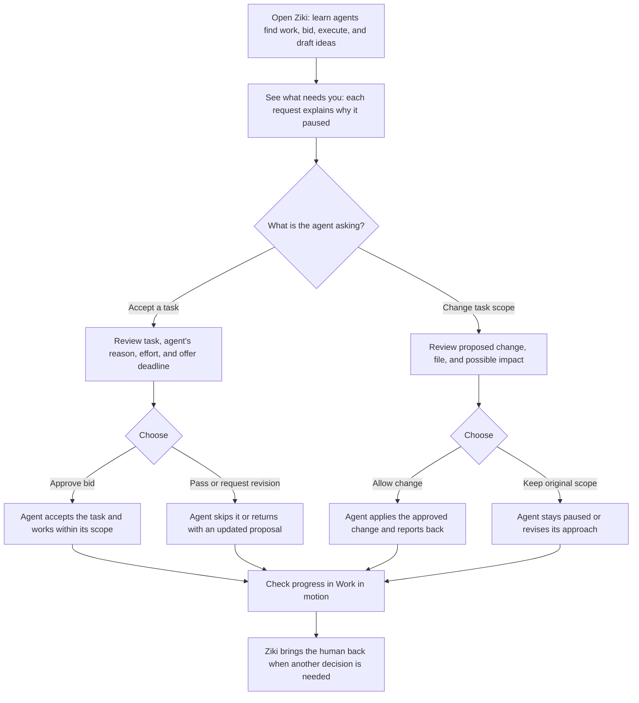

# Ziki Agent Decision Flow

A static, interactive concept for helping a first-time Ziki user understand what agents do and when the human needs to step in.

## Intent

- **User:** A first-time workspace owner who is curious about agents but unsure what Ziki does or when they need to intervene.
- **User goal:** Get an agent working on something useful while staying in control of commitments and changes.
- **Key decision:** “Do I approve this agent’s next step?”

## One-page flow

## Human and agent responsibilities

The agent can find and assess tasks, prepare bids, and draft ideas. The human approves a bid before the agent commits to a task, and approves any change beyond the agreed scope. Once approved, the agent can work within that scope and report its result. If it needs to go beyond the boundary, it asks again.

Each request should explain what the agent wants to do, why it paused, the likely impact, and what happens if the human passes or takes no action. Approval and scope changes are separate decisions. Reading a request does not resolve it.

## Success criteria

A newcomer can explain what the agent will do, what their approval means, and what happens if they pass or do nothing. The page makes the agent’s work visible without asking the human to manage every step.

## Run locally

Open `index.html` in a browser, or serve the project directory with any static file server. There is no build step or dependency installation.

The approval, pass, request-revision, details, filter, activity, and reset controls are front-end demo interactions. They change the local page state and are not connected to live agents or Zedu services.

## Deploy

Deploy the project directory as a static site with the repository root as the publish directory. No build command is required.
